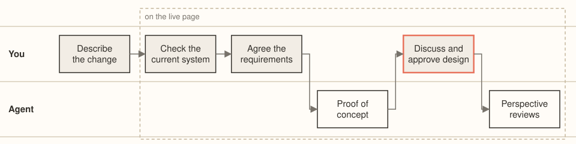

# `/architect-better`

Designs a feature or a change to a software system. You check how the system works today, agree what the change needs to do, and discuss the design on a live page.

*You check the diagrams before and after the change, see review findings on the parts they concern, see which agents are at work, and click any box, arrow or step to comment on it.*

## When to use it

- You plan a feature or a structural change, such as adding a module, changing a data model or planning a migration.
- You want a map of the system as it is today.
- You want an existing design reviewed, or to check how a system matches its design.

Running it does not mean a new design. The work can end with the system drawn as it is, with an audit report, or with a note that the change adds no structure and needs no design.

Use something else nearby:

- For a change inside the current structure, go straight to [`/code-better`](code-better.md).
- For screens, layout or flow, use [`/design-better`](design-better.md).

## What you can do with it

| You want to | Run | You get |
|---|---|---|
| Design a change | `/architect-better move invoice exports to a background job` | A design, decision records and a spec for `/code-better` |
| Map the system as it is | `/architect-better` and stop once the current system is drawn | Container and flow diagrams checked against the code |
| Compare two designs | Ask for alternatives during the design | Each design drawn, with its strengths and drawbacks, to choose from |
| Audit a design or a system | `/architect-better audit the invoice export design` | Findings tied to diagram parts; nothing changed |

In every design, it:

- **Draws the current system.** It checks the affected containers and flows against the code and asks you to correct the drawing. Where the change has a process with decisions, loops back and exits, or a lifecycle, it draws a logic flow; where trust or hosting matters, it groups the boxes by trust zone or by where they run. It draws only the views the change touches.
- **Agrees requirements with you.** It drafts observable scenarios for quality attributes, marks its guesses and shows where each requirement came from.
- **Shows options and trade-offs.** It recommends a design, explains why it rejected alternatives and records the main drawback of each choice.
- **Tests what documentation cannot settle.** When a choice rests on how a tool or library behaves, it proposes a throwaway proof of concept with the questions it must answer, runs it once you agree, and writes what it observed into the design. A result that contradicts a choice comes back to you.
- **Reviews the design after you approve it**, with a separate review for each perspective that applies, such as security, failure handling, agent experience or API standards.

## Your workflow

*Your steps are on the top lane, the agent's on the bottom one. The terracotta outline marks where your input matters most.*

1. **Start it** with the change. It opens a live page.
2. **Check the current system** on the Before diagrams, and correct what is wrong.
3. **Agree the requirements**: confirm each guessed requirement, or choose Change to correct it.
4. **Discuss the design** on the page: click a box, arrow or step to comment, and the agent replies under your message. When a choice rests on how a tool behaves, agree to the proof of concept it proposes; the results come back into the design.
5. **Approve it.** The perspective reviews run on their own and attach findings to the parts they concern. Revise, then choose **Review again…**.
6. **Hand the spec to [`/code-better`](code-better.md)** to build it.

## How long it takes

**How you work with it:** a live design session. You are on the page for most of it: checking diagrams, agreeing requirements and commenting on the design. Only proofs of concept, the perspective reviews and the audit run without you.

| Work | Rough time |
|---|---|
| Map of the current system | 10–20 min |
| Design of a small change | 15–30 min |
| Design of a feature or structural change | 30–60 min |
| Audit | 15–45 min |

It takes longer when the current system has no diagrams yet, when you ask for alternatives, when a choice needs a proof of concept, and when a review leads to a revision.

## Reference

<b>The live page</b>

Switch between Before and After in Containers and Flows, or between Before and each alternative design, with its strengths and drawbacks above the diagram. When the design groups its boxes by trust or by where they run, switch Containers between Systems, Trust and Where it runs; arrows that cross a trust boundary carry a mark. Overview lists the alternatives side by side. Click a box, arrow or step to comment. Confirm a guessed requirement or choose Change to correct a row. The agent replies under your message.

The Agents list at the top of the conversation shows each reviewer, proof of concept or spec check at work.

Choose **Approve…** to approve the design, with your open comments, and start perspective reviews. When the design has alternatives, choose which one to build, or ask for a combination or for none of them; the alternatives you did not choose are recorded as rejected. When a finding appears, select its linked part to see where it applies. After a revision, **Review again…** shows what changed in the diagrams, the requirements or `design.md`, and reruns the perspectives those changes affect.

<b>What you get</b>

- A design document with goals, diagrams, design choices and unresolved questions.
- Decision records with their drivers, chosen options, rejected alternatives and main drawbacks.
- An implementation spec with verifiable requirements and source links, ready for [`/code-better`](code-better.md).
- In audit mode, a report of findings tied to diagram parts. The audit makes no changes.

<b>Works with</b>

- [`/ask-better`](ask-better.md) for the questions about gaps and requirements.
- [`/decide-better`](decide-better.md) when you choose between design options.
- [`/review-better`](review-better.md) to confirm the perspective reviewers' findings and to hold a finding you dispute.
- [`/write-better`](write-better.md) for the final report.
- [`/do-better`](do-better.md) when you reject the result.
- [`/code-better`](code-better.md) builds from the design and spec, and points you here for a structural change without a design.
- `/review-better` uses `/architect-better`'s checks when it reviews a software design.

<b>How it is tested</b>

Tested on 23 situations with Sonnet 5.5 (2026-11-21).

| What it does | Passed |
| --- | ---: |
| Asks about costly gaps at once, questions a solution that works against the goal, raises a conflict with a recorded decision, has the user confirm the current system before designing, and asks what to design when given no request | 83% |
| Draws the current system from the code, flags vendor claims no source supports, traces each requirement to its source, changes a disputed finding only on evidence, and audits the system against its design | 67% |
| Compares options with their drawbacks, states quality attributes as scenarios, lists every perspective, keeps the current system's part IDs in the change, and states failure cases in the spec | 93% |
| Reviews only an approved design, with a fresh reviewer per perspective, ties findings to diagram parts, and has a separate agent check the spec | 100% |
| Saves the design and decision records where and how the repo keeps them, designs nothing when the structure does not change, changes nothing in an audit, and says at hand-back what is approved, reviewed and still open | 87% |

