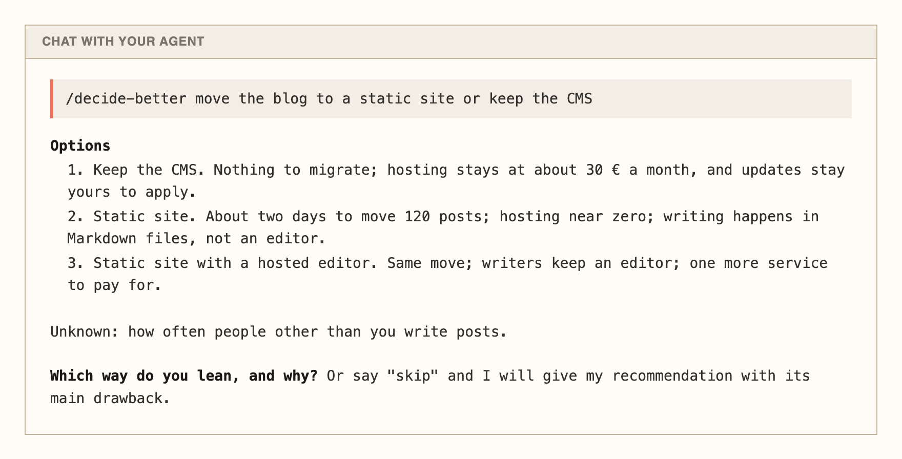
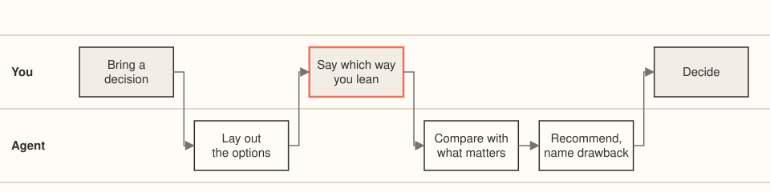

# `/decide-better`

Helps you make a decision yourself, so the choice fits what matters to you and rests on your own judgement.

*It lays out the options and what is unknown, then asks which way you lean before it gives its view.*

## When to use it

- Before a decision you will live with, such as a plan, a tool, a job or a purchase.
- When you notice you are taking the agent's answer without weighing it.

You rarely need to name it: other skills use it when you must choose (see Works with below).

Running it does not mean a long method. A small or easy-to-reverse decision ends with one recommendation and its drawback.

## What you can do with it

| You want to | Run | You get |
|---|---|---|
| Think through a decision | `/decide-better move the blog to a static site or keep the CMS` | The options, a comparison against what matters to you, and a recommendation with its main drawback |
| Weigh the decision in the conversation | `/decide-better` | The same, for that decision |
| Get only the answer | Say "just tell me" | Its recommendation, the main reason and the main drawback |
| Look back at a past decision | `/decide-better` on the decision | A judgement by what was known at the time, not by how it turned out |

In every decision, it:

- **Separates your decisions from its own.** It makes the decisions about how to carry out your choice, and states them; it brings you the ones about your goals, money, time, people, or work you will maintain.
- **Asks which way you lean before giving its view**, unless you already said; you can skip, and it then stops asking.
- **Checks each option against what matters to you**, using the criteria you stated or the two or three you name.
- **Gives its recommendation with the main drawback**; if it agrees with your leaning, it gives the strongest case against it.
- **Asks instead of judging** when the options differ mainly in which of your values wins.

## Your workflow

*Your steps are on the top lane, the agent's on the bottom one. The terracotta outline marks where your input matters most.*

1. Run it with the decision, or when another skill brings you a choice.
2. Say which way you lean and why, and the two or three things that matter most. Or skip.
3. Read the comparison and its recommendation with the main drawback.
4. Decide. The decision stays yours.

## Reference

<b>What happens</b>

1. **It names the decision and who owns it.** It makes the decisions that are its own and states them.
2. **It sizes the decision.** For a small, reversible or urgent one, it gives its recommendation, the main reason and the main drawback, and stops.
3. **It lays out the options**, including keeping things as they are, with what is likely to happen and what is unknown. It does not give its view yet.
4. **It asks which way you lean, and why**, and for the two or three things that matter most if you have not said. You can skip.
5. **It compares the options against your criteria**, with the evidence in each cell and unknowns marked.
6. **It gives its view.** It recommends one option, with the main reason and the main drawback. If it agrees with you, it gives the strongest case against your leaning; if it disagrees, it says why once, with the evidence. You decide.
7. **For a choice between your values**, it shows what each option costs on each value and asks questions instead of recommending.

When you look back at a past decision, it judges it by what was known at the time, not by how it turned out.

<b>What you get</b>

- The options, with likely outcomes and unknowns.
- A comparison of the options against your criteria.
- A recommendation with its main reason and main drawback, or questions when the choice is between your values.

<b>Works with</b>

It calls:

- [`/ask-better`](ask-better.md) for its questions.
- [`/write-better`](write-better.md) for the words.

It is called by:

- [`/ask-better`](ask-better.md) when a question asks you to make a decision that is yours.
- [`/write-better`](write-better.md) when a text is for a decision you make.
- [`/code-better`](code-better.md) when it shows you design decisions before building.
- [`/review-better`](review-better.md) when you must choose between fixes.

<b>What it needs</b>

- **Asking you.** Without it, it gives its view after the comparison and says it is one input to your decision.

