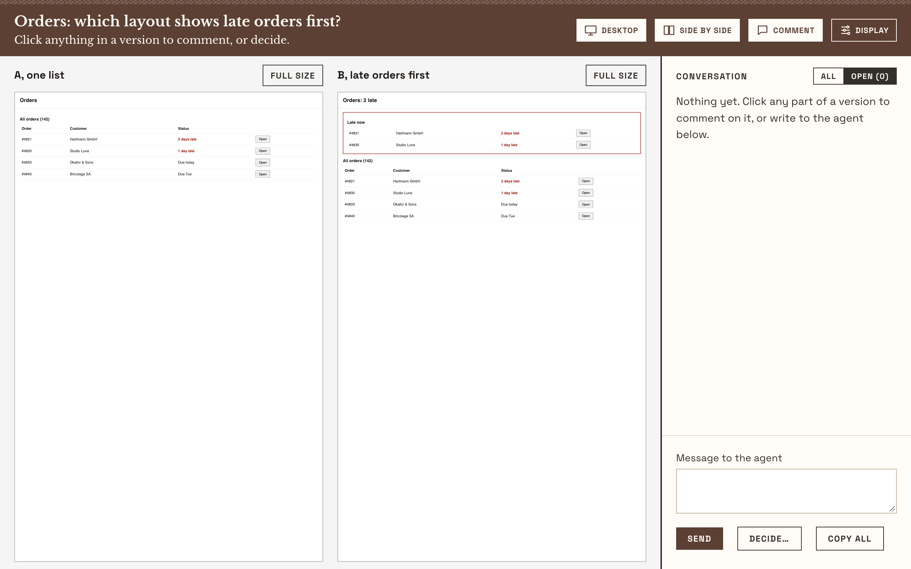

# `/design-better`

Designs, builds and reviews an interface so the people who use it can do what they came for.


*You compare versions on one page, and click any part of a version to comment on it or Decide.*

## What it does

- **Shows you versions to choose from.** For a new page or a layout change, it puts two or three rough directions side by side on one page, before it builds.
- **Agrees the tasks first.** A short brief: who uses the page and what they come to do, as scenarios with real data.
- **Checks by using the page.** It walks each scenario by pointer, by keyboard and on a small screen.
- **Keeps your design language.** When a rule, such as text contrast, clashes with it, it tells you and follows your decision.

For example, to get late orders found first:

```
/design-better the orders page
```

## Reference

<details>
<summary><b>When to use it</b></summary>

- To design, build or change an interface: a web page, an app screen, a rendered report.
- To review an interface, yours or someone else's.
- To create, extend, change or review a design language: the named colours, type, spacing and components that give a set of interfaces one look.

Use something else nearby:

- To introduce a dense document with visual panels, use [`/show-better`](show-better.md).
- For the words in the interface, such as labels, button text and messages, `/design-better` calls [`/write-better`](write-better.md) itself.

Being invoked does not mean a redesign. A run can end with a brief and a few questions for you, or with a report that the interface already works for its audience.

</details>

<details>
<summary><b>How to run it</b></summary>

```
/design-better <interface or task>
```

Example: `/design-better the settings page, so people can find and change their email`.

It picks one of three modes from the task:

| Task | Mode |
|---|---|
| Design, build or change an interface | build |
| Review an interface or a design language | review |
| Create, extend or change a design language | language |

Without an argument, it reviews the interface the conversation is building, then continues or corrects the work. If there is none, it asks which interface or design language to work on, and whether to build, review or change it.

</details>

<details>
<summary><b>What happens</b></summary>

1. **It reads first.** It reads the existing interface, its styles, components and design files, the content, and the project's instructions. It does not ask you what these already answer.
2. **It writes a brief.** For anything more than a small change, it writes the goal, the audience, a few scenarios (one task each, from start to an end you can observe, with real data), and the pages and what each holds. It asks whether each page or part should stay, merge or go.
3. **It asks a few questions.** At most about three, all at once, before building, each answerable in a few words. A question about how something looks becomes versions you choose between, not a text description.
4. **It shows directions.** For a new interface or a change to structure, layout or flow, it first asks whether you have a direction or references in mind. Then it shows two or three rough directions that differ in structure or emphasis, not only in colour. It reviews new directions before showing them.
5. **You compare versions on one page.** Versions appear side by side at the screen sizes in the brief, with a switch to flip between them in place. When your browser runs on the same machine, the page is served live:
   - Click any part of a version to comment on it.
   - Give each version a thumbs up or down when there are three or more.
   - Choose one version, a combination or none with Decide.
   - The agent replies under your comment and marks it seen, working or done. Accept a done item with the ✓ next to Reply, or reply under it to send it back.
   - Every message, the agent's included, can be answered with Reply. The conversation opens at the latest message, and what you are typing survives new replies.
   - Open lists what is not accepted yet, and the agent's questions until you answer them.
   - New versions load by themselves once you stop typing. If the agent's server stops, a strip under the bar says the canvas is closed.
6. **It builds.** It keeps your design language. If a rule such as text contrast conflicts with it, the agent reports the conflict once and follows your decision. It changes a few visual things at a time and shows each batch before and after. It decides empty, loading, error and other edge states.
7. **It checks by walking.** It operates the rendered interface for each scenario: with a pointer, by keyboard only, and at the smallest screen width. It reads the labels and headings without the visual page, runs an accessibility checker if one is available, and stops fixing after about three rounds or when a fix breaks a scenario that passed.
8. **A separate reviewer reviews it.** The reviewer gets the interface, the brief and your decisions, not the builder's reasoning. A finding counts only if it names a scenario step where a person is stopped or slowed.

</details>

<details>
<summary><b>What you get</b></summary>

- A brief, from `templates/brief.md`, in the project or in the reply.
- A compare page at `.design/<slug>/index.html`, with your feedback appended to `answers.jsonl` next to it. It is not committed unless you ask.
- The built or changed interface. When a change alters how it looks, a page showing each changed screen before and after, and the same screenshots in the pull request when the change goes into one.
- A short report:
  - which scenarios it walked and how, and which failed or could not be walked
  - the decisions that are yours: conflicts with the design language, and assumptions that changed the build
  - review findings it could not confirm
- For a new interface or a changed main flow that other people will use, an offer of a short test: you watch three to five people from the audience try the scenarios. When the pages or their names change, it offers a tree test instead, and after a test leads to changes, a second short round.
- In language mode, a design language document with values in tables, one name per value shared by the document and the code.

The report keeps three claims apart: the scenarios can be completed, the checks pass, and the audience can use the interface. Only a test with people shows the last one.

</details>

<details>
<summary><b>Works with</b></summary>

- [`/code-better`](code-better.md) for the code that implements the interface.
- [`/ask-better`](ask-better.md) for the questions before building.
- [`/write-better`](write-better.md) for the words in the interface and for the final report.
- [`/review-better`](review-better.md) to run the review, with design-better's rules as what to look for.
- [`/do-better`](do-better.md) when you reject the result.
- `/review-better` uses `/design-better`'s checks when it reviews an interface or a design language.

</details>

<details>
<summary><b>What it needs</b></summary>

| Capability | Without it |
|---|---|
| Python 3 | If it can still render, it writes one HTML page with the versions side by side at the same width. |
| A browser that can reach the machine | It publishes the page, whose Copy all button copies your feedback for the chat. If it cannot publish, it opens the page and gives you its path. |
| Rendering a page | It shows each version as a plain text outline and says the choice may change once rendered. |
| Being told about your feedback as it arrives | It asks you to say "sent" in the chat, then reads your feedback from `answers.jsonl`. |
| Operating the page by pointer and keyboard | It looks for a headless browser or automation library first. If none works, it says so and lists the walks for you to do. |
| An accessibility checker | It says none ran, and relies on the walks and reading the markup. |
| Sub-agents | It reviews in a separate pass after building, re-reading the brief first. |
| Writing files | It puts the brief and the design language in its reply. |

</details>
