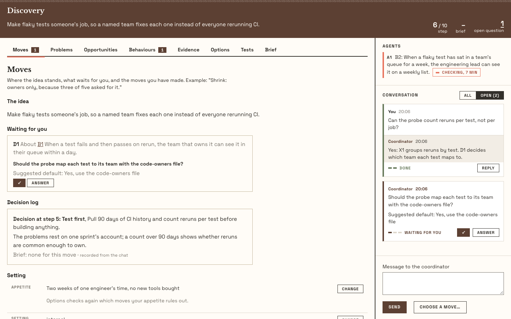
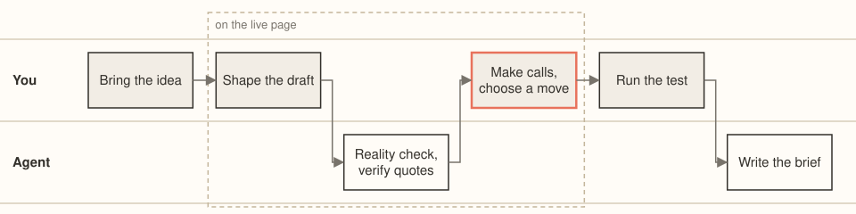

# `/discover-better`

Takes your product idea to a brief for design, in versions. It drafts what the idea assumes, checks it against evidence, asks you only what you can decide, and has you choose each move, from testing first to dropping the idea.

*You answer what only you can decide, take a suggested default with one click, and choose each move. Analysts check evidence in the meantime.*

## When to use it

- You have an idea for a product or a feature and want to know whether to build it, test it first, change it or drop it, before any design.
- The idea serves your own organisation, such as a tool for your team, or customers.
- You have evidence from a test or from real use and want to choose the next move.

Running it does not mean running every step. A discovery can end early with Stop, Switch or Adopt.

Use something else nearby:

- To research a topic rather than shape an idea, use [`/research-better`](research-better.md) instead.
- To design an interface or a system you have already decided to build, use [`/design-better`](design-better.md) or [`/architect-better`](architect-better.md).

## What you can do with it

| You want to | Run | You get |
|---|---|---|
| Shape and check a new idea | `/discover-better make flaky tests someone's job` | The idea's problems, opportunities and behaviours, checked against evidence |
| Test the idea cheaply first | Choose Test first | The cheapest test, with what would stop or change the idea written before it runs |
| Commit to a version | Choose Expand, Shrink, Adopt or Stop | A brief version with the decision and its evidence, handed to design for Expand or Shrink |
| Resume a discovery | `/discover-better`, or the same idea again | The discovery where you left it, with new evidence added |

In every discovery, it:

- **Breaks your idea into what it rests on.** Problems, opportunities and behaviours, each with its risks: would people want it, could they use it, can it be built, can it be sustained. Each behaviour is written as "When [situation], [who] can [observable result]", with a testable form, and checked for wording two readers would read differently.
- **Shapes the idea with you before checking it.** It asks who faces the problem and what they last did about it, turns your statements into questions, and proposes an alternative idea only once yours is on record.
- **Runs a reality check.** Analysts look for what already does it, whether the problem is real, what research says and what would strengthen the idea, with evidence for and against. Analysts read the web, and the files and connectors you name, such as an MCP server, only with tools that read.
- **Counts a quote only once it is checked.** A separate verifier re-reads each quote's web page, file or connector item itself and checks that the quote is on it. A result computed from your data counts once you confirm it.
- **Separates evidence about your users from evidence from elsewhere.** An item supported only by evidence from elsewhere shows as not yet known for your users.
- **Leaves your calls to you.** Each question has a suggested default you take with one click, and none is ever applied by silence. Only you accept a risk.
- **Has you choose each move.** Test first, Expand, Shrink, Switch, Adopt, Pause or Stop, each option with its cost, speed, upkeep and how hard it is to undo. Expand, Adopt and Stop ask you to confirm.
- **Writes a brief for each move that commits.** Each version is kept and names the move that wrote it. Expand and Shrink briefs are handed to [`/design-better`](design-better.md) and [`/architect-better`](architect-better.md).

## Your workflow

*Your steps are on the top lane, the agent's on the bottom one. The terracotta outline marks where your input matters most.*

1. **Start it** with your idea and any notes. Say your appetite and what you would waste if the idea is wrong.
2. **Shape the draft** by answering its questions about who faces the problem and what they do today.
3. **Read the reality check** while analysts gather evidence, and add evidence about your own users: your data, your notes, people you can ask.
4. **Make your calls** on the live page: answer the open questions, accept or refuse risks, and choose a move.
5. **Run the test** if you chose Test first, by yourself, with an analyst, or with `/code-better` for code. Bring the result back to choose the next move.
6. **Hand the brief on** to design when you choose Expand or Shrink.

## How long it takes

**How you work with it:** a guided session over several sittings. You answer questions and choose each move on a live page; analysts and verifiers check evidence without you in between.

| Work | Rough time |
|---|---|
| Draft and shape the idea | 20–40 min, with you |
| Reality check | 20–60 min, without you |
| One pass to a move | 1–2 h |
| Whole discovery with tests | Days to weeks, set by how long your tests take |

It takes longer when you test before committing, and shorter when the idea stops or switches early.

## Reference

<b>What happens</b>

1. **Your idea and appetite.** You bring the idea and any notes. It asks for your appetite, what you would waste if the idea is wrong, and whether the idea serves your own organisation or customers.
2. **The draft, shaped with you.** It drafts the problems, opportunities and behaviours, then asks questions to shape and challenge them. The idea can already stop or switch here.
3. **The reality check.** Analysts check whether something already does it and whether the problem is real. If what exists covers the idea, you can adopt it.
4. **Evidence about your users.** Your data, your notes, the people you can ask.
5. **Your calls.** The open questions and the risks only you can accept, then the move.
6. **The cheapest test**, if you chose to test first: a probe, a proof of concept or a pilot, with what would stop or change the idea written before it runs.
7. **The test runs**, by you, an analyst, or [`/code-better`](code-better.md) for code. The result comes back as evidence, and you choose the next move.
8. **A brief version**, for Expand, Shrink, Adopt or Stop: the decision and why, the items and their evidence, the tests, and the open questions for design.
9. **The hand-on** of the brief to design, for Expand or Shrink.
10. **What real use shows**, in a later session, comes back as evidence for the next move.

The discovery lives in `.discover/<idea>/`, and the brief versions in its `brief/` folder. Git sees it as untracked: commit it or ignore it as you choose.

<b>The live page</b>

The page opens on **Moves**: your idea, what waits for you, the moves made so far with the brief each one wrote, and your setting, which you can change. Tabs for **Problems**, **Opportunities** and **Behaviours** show each item with its state and evidence. **Evidence** splits what is about your users from what comes from elsewhere, and lets you add evidence of your own. **Options** compares the options of each move. **Tests** lists the tests and lets you add a result. **Brief** shows the current version and the earlier ones.

Answer a question with ✓ to take its default, or with Answer. Choose a move with **Choose a move…** next to Send. The analysts at work are listed above the conversation.

<b>What you get</b>

- A brief for each move that commits, kept as versions, ready for design.
- The items, evidence, tests, options and moves as records in the discovery's folder, so the work can resume in a later session.

<b>Works with</b>

- [`/ask-better`](ask-better.md) for the questions to you.
- [`/decide-better`](decide-better.md) when you choose a move.
- [`/code-better`](code-better.md) to build a proof of concept for a test.
- [`/design-better`](design-better.md) and [`/architect-better`](architect-better.md) take the brief on.

