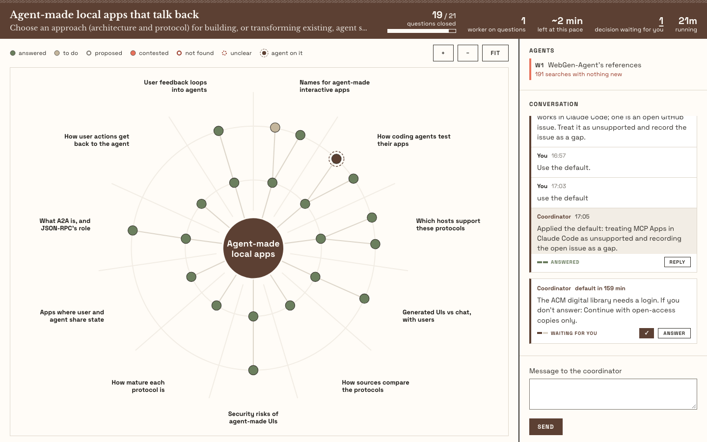

# `/research-better`

Researches a topic from sources instead of the model's training data, and writes a report with citations. It tracks questions, sources and claims on a research board, lets cheaper worker agents research in parallel, and has separate agents check each claim against the source page.

*The live board: the questions as a map, the agents at work, and a conversation with the coordinator.*

## When to use it

- To answer a question from sources: a topic to understand, a choice to make, a review of what is known.
- To learn a field and see where the reading leads, in explore mode.
- To answer a simple factual question, such as a date or a current value.
- To research your organisation's own systems or decisions, from the internal tools your agent can reach, such as a wiki or ticket tracker.

Use something else nearby:

- To shape a product idea into a brief, use [`/discover-better`](discover-better.md).
- To introduce the finished report with visual panels, use [`/show-better`](show-better.md).

## What you can do with it

| You want to | Run | You get |
|---|---|---|
| Answer a question | `/research-better do code review checklists reduce defects?` | A report with APA citations, where sources disagree, and open questions |
| Learn a field | `/research-better explore incident review practices` | A map of the branches the sources led to, with what each found |
| Check a fact | `/research-better when did Python 2 reach end of life?` | One or two sentences, with the source |
| Resume earlier research | `/research-better` | The research continued from its board |

In every research, it:

- **Searches before asking**, to see which meanings sources give your topic, and asks only if several remain.
- **Has cheaper worker agents research questions in parallel**, each recording every query, source and claim with a verbatim quote.
- **Has separate agents check each claim** against the source page.
- **Looks for contradicting evidence** for each key answer, and stops when results stop adding anything new, not when it finds the answer it expected.

## Your workflow

1. **Start it** with your question. Answer which meaning you meant if it asks.
2. **Check the depth it chose** (quick, standard or exhaustive) and correct it if needed.
3. **Follow the live board** if you want: ask about a question, change the scope, or drop a branch. You don't have to: it does not wait for you.
4. **Answer decisions** it posts mid-run, or let the safe default apply at the deadline.
5. **Read the report**: the answer first, then where evidence is weak, and the open questions.

## How long it takes

**How you work with it:** it researches on its own. A live board shows the work, and you can steer from it, but the research does not wait for you.

| Work | Rough time |
|---|---|
| Factual question | 1–2 min |
| Question for a quick decision | 10–20 min |
| Standard research | 20–60 min |
| Exhaustive review, or explore mode | 1–3 h |

It takes longer for a broad topic, for sources in several languages, and for deeper exploration.

## Reference

<b>What happens</b>

1. **It searches before asking.** It runs a search or two with the topic's own words to see which meanings sources use. If the topic still has several meanings, it explains each and asks which one you meant.
2. **It picks the depth.** It chooses a goal and a stop level: `high` for a quick decision, `medium` by default, or `low` for an exhaustive review from what you need. It does not ask you for a budget, and says what it chose so you can correct it.
3. **It opens a board** in `.research/<topic-slug>/` and tells you the path. If it can, it opens the live board in your browser (see The live board below).
4. **It seeds questions** from your question and from broad searches, including searches in other languages when the topic has sources there. Each question says what evidence would answer it.
5. **Workers research the questions.** Each records every query, source and claim on the board as it goes, with a verbatim quote for each claim. As they read, they add questions:
   - newer work, origins, other fields, other regions and critics
   - the works a key source cites and the works that cite it
   - for each key answer, a challenge question that looks for contradicting evidence
6. **Verifiers check claims while the research runs.** A verifier opens the source page, copies the passage the claim rests on, and judges the claim from it. The coordinating agent reads their flags and compares key claims with the copied passages.
7. **It stops** when no question at the stop level is still open, or when results stop adding anything new after one change of strategy. It does not stop because it found the answer it expected.
8. **It presents the findings** with APA citations, a reference list built only from the board, what each challenge question found, and the questions that remain open.

<b>Explore mode</b>

When you ask to explore or learn a field rather than answer a question, it runs in explore mode and says so. The evidence rules stay the same; what changes:

- **Scope:** a topic a source raises outside your first question becomes a new question, not out of scope. Each records the source that raised it and the question it came from, so the board shows the path from your topic to each new one.
- **Priority:** a topic ranks higher the more independent sources raise it, or the more central it is to the source that does.
- **Depth:** it follows topics up to three steps from the first questions, unless you set another limit. Deeper topics are listed as leads.
- **Stopping:** it stops when no question at the stop level is left within that depth, or when reading stops adding new sources, terms or topics.
- **Report:** a map of the branches, with the path to each topic, the source that raised it and what the branch found.

It adds a topic only when a source it read names it, never because it expects the topic to matter. From the live board, ask it to drop a branch, keep a topic, or end the run.

If a source it needs is unreachable (a missing tool, a login, an error), it does not fill the gap from other sources or from memory. Before the research runs, it tells you and asks whether to wait, continue without it, or read sources you give it. Once it runs, it does not stop to wait for you: it records a decision with a safe default and a deadline (see below) and keeps working. It never puts internal names or text in a web search.

Without a live view, it posts one line in the chat each time a question closes.

<b>The live board</b>

The board fills one window and updates as the agents write:

- **The figures** at the top: questions closed, workers busy, time left at the current pace, decisions waiting for you, and how long it has run.
- **The map:** each first question is a slice, named at the edge; each ring out is a question raised one step further. A dot's colour and outline show its state, and the key explains each one. Scroll, use the buttons or double-click to zoom; drag to move; Fit brings the whole map back.
- **Pop-ups:** click a question for its short answer, its evidence and the full question with its claims; click an agent for its latest searches. You can ask about either from the pop-up.
- **The agents** at work, each with its question. An agent that keeps searching without finding anything new says so in red.
- **The conversation** with the coordinating agent: write to it, reply to any message, and see each message move from seen to answered. Messages on both sides show Markdown, such as lists, tables and code. When you change the scope, the coordinator writes the change to the board, and workers apply it before their next write, not only at their next question. Each worker posts a short message when it closes a question, with its one-line answer, and the coordinator posts what it changed each time it reviews the board, such as questions it opened or merged and claims it corrected after verification. Questions and answers on the board have short titles and one-line answers written for a quick read. A band at the top lists any record in the board's files that does not fit its schema; the records it names show as not valid.
- **Decisions waiting for you.** When something only you can decide comes up mid-run, the coordinator posts it at the bottom of the conversation with its default and a deadline (10 minutes at most, never past the expected end). Accept the default with ✓, answer differently, or let the deadline pass. You can change a decision later; that reopens a stopped board.

When the board's server stops, a strip says the board is closed; ask the agent to restart it. The coordinator reads what you wrote while it was away when it resumes the board.

<b>What you get</b>

- A research board in `.research/<topic-slug>/`, as JSON files: `brief.json` (the topic, its meaning, your goal, the mode and the state of the run), `questions/`, `claims/` (each with its verbatim quote and the verifier's verdict and copied passage) and `sources/`, one file each, `logs/` (each agent's searches), `decisions.jsonl` (the decisions taken during the run), and your conversation with the coordinator (`conversation.jsonl`). Git sees it as untracked, so commit it or ignore it as you choose. A later session can resume from it.
- Records that fit their schema. Each record is stamped and checked against its schema when it is written, with `better.pyz add`, `set` and `check`, and the live board lists any record that does not fit, with its file, line and field, instead of hiding it. Nothing others point to is deleted: a wrong claim is marked withdrawn, a source that copies another is marked a duplicate, and a duplicate question is merged into the one that covers it.
- A live board while the research runs, or progress lines in the chat.
- A report: the answer first, where sources disagree or evidence is weak, citations in APA style (7th edition), a reference list, and open questions or blocked sources that could change the answer.

<b>Works with</b>

- [`/write-better`](write-better.md) writes the final report.

<b>What it needs</b>

| Capability | Without it |
|---|---|
| Search and page reads | If a source the topic needs cannot be searched, it tells you and asks how to continue. It does not describe pages it could not open. |
| Sub-agents | It runs the research loop itself, one question at a time. |
| Background sub-agents | It starts a group of workers, waits for them, then starts the next group. |
| Choosing a worker's model | It runs workers on a cheaper model than its own when it can, and does not create or edit harness configuration without your permission. |
| Background commands and a browser that can reach the machine | It tells you how to start the live view yourself, or posts progress in the chat. |
| Writing files | It keeps the board in its working notes and restates it every few results. |
| Asking through a tool | It asks in plain text and waits for your answer. |

<b>How it is tested</b>

Tested on 18 situations with Sonnet 5.5 (2026-11-21), each searching a planted wiki with no web access.

| What it does | Passed |
| --- | ---: |
| Keeps the board on disk in its format, copies quotes and source details from the page, and marks repeats and blocked sources | 61% |
| Asks before the research runs when a collection is missing, records a decision instead of waiting once it runs, and reports only what the board holds | 72% |
| Leaves the research to workers, has claims checked by verifiers that did not record them, and keeps the board's questions in order | 89% |

