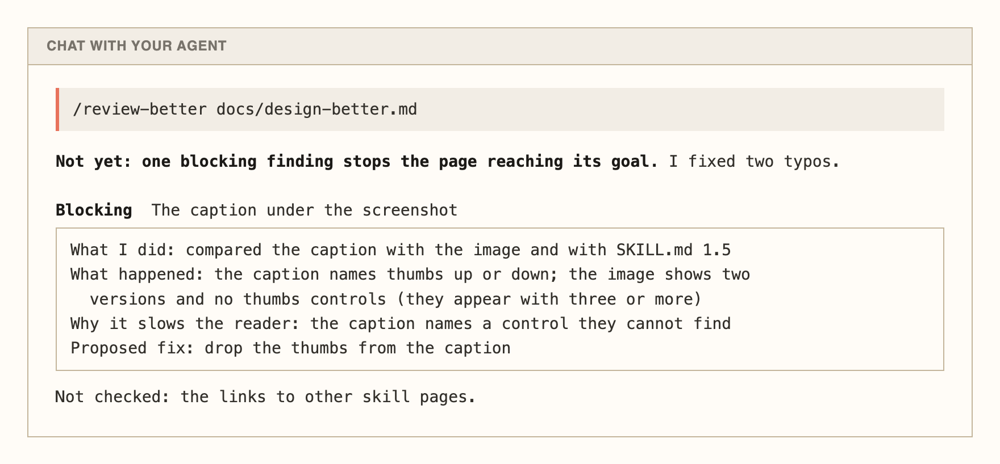
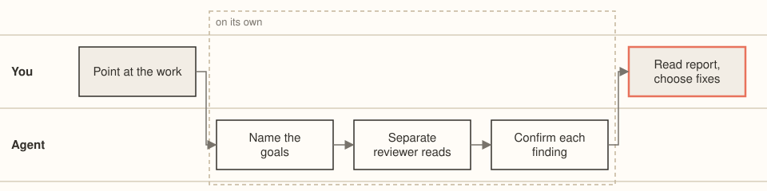

# `/review-better`

Reviews work, such as text, code, an interface, a plan or a research report, so that each finding leads to a fix, an answer or a decision.

*The report opens with whether the work reaches its goal. Each finding names the check behind it and an action.*

## When to use it

- You want a review of a file, a diff, a pull request, a link or work in the conversation.
- You want findings you can act on, not a long list of remarks.

The method is the same for all work. The skill for the kind of work adds what to look for:

| Work | What to look for comes from |
|---|---|
| Code, a diff or a pull request | [`/code-better`](code-better.md) |
| An interface or a design language | [`/design-better`](design-better.md) |
| A software design, or a system against its design | [`/architect-better`](architect-better.md) |
| Text you read | [`/write-better`](write-better.md) |

For a plan, a specification or a research report, it writes three to six kinds of problem from the work's goal and requirements.

A review can end with no findings. It then says so in one sentence, with what it checked and how.

If you rejected a review and want it corrected, use [`/do-better`](do-better.md).

## What you can do with it

| You want to | Run | You get |
|---|---|---|
| Review a file, a pull request or a link | `/review-better https://github.com/acme/app/pull/42` | A report with the fixes it made, findings with actions, and questions for the author |
| Review the work in this conversation | `/review-better` | The same, for that work |
| Review against your own criteria | Run [`/interview-me`](interview-me.md) `review` once | Your blocking criteria count as blocking findings in every review |
| Get a thorough review | Ask for a thorough review | A second independent reviewer |

In every review, it:

- **Agrees what the review is for**, and looks for the few problems that would stop the work reaching its goal.
- **Uses a separate reviewer**, from a different model when it can, and backs each finding with a check it ran.
- **Fixes what is simple, asks what only the author knows**, and lays out the options when there are several.

## Your workflow

*Your steps are on the top lane, the agent's on the bottom one. The terracotta outline marks where your input matters most.*

1. **Start it** on the work. Answer its one question if the work's goal is unclear.
2. **Let it review.** A separate reviewer reads the work, and it confirms each finding with a check.
3. **Read the report**: whether the work reaches its goal, the fixes it made, and the findings marked blocking or suggestion.
4. **Answer its questions and choose between fixes** where there are several.

## How long it takes

**How you work with it:** it reviews on its own, then brings you the questions and choices only you or the author can settle.

| Work | Rough time |
|---|---|
| Short text or small diff | 5–10 min |
| Document or pull request | 15–30 min |
| Thorough review with a second reviewer | 30–60 min |

It takes longer when confirming findings means running code or opening many sources.

## Reference

<b>What happens</b>

1. **It names two goals.** One is what the review must let the author do, such as ship, decide or improve. The other is what the work's own reader must do. It reads what the work answers to: the request, requirements, brief, sources, and decisions already made. A decision already made is not a finding. If the work's goal is unclear and nothing answers it, it asks you one question.
2. **It names the author.** If the work belongs to someone other than you or the agent, it proposes changes instead of making them, unless you ask.
3. **It writes a short list** of the kinds of problem that would stop the work from reaching its goal.
4. **A separate reviewer reads the work.** This is a sub-agent that sees the work, the goals and the list, but not the agent's reasoning or verdict. When it can, it uses the model the reviewer's agent file names, or a strong one, such as Opus or Sol, and of those, a different model from the one that made the work. You can name another model for a run or for the skill, and the report says which model ran each review. For a thorough review, or when a miss would be costly, it runs a second independent review. After fixes, it checks the fixes instead of running another full review.
5. **It confirms each finding.** It runs the code, reproduces the problem, opens the source, recomputes the number, or quotes the exact passage. A finding it cannot confirm stays in the report, marked unconfirmed, with what would settle it.
6. **It acts on each finding by kind:**
   - a simple fix with one right answer: it fixes it and lists the fix
   - something only the author knows: it asks
   - several reasonable fixes: it explains them, recommends one, and asks you to choose
   - anything else: it proposes a specific change
7. **It holds a finding you dispute without evidence.** It changes a finding only when your argument adds evidence or shows the finding misread the work. It opens any source you cite before counting it.

<b>What you get</b>

A report that leads with whether the work reaches its goal, and what blocks it if not. Then it lists:

- the fixes it made
- the findings, ordered by effect, each labelled **blocking** or **suggestion**, with where, what is wrong, its effect and the action
- questions and choices for the author
- unconfirmed findings, listed separately

It ends with what it did not read, run or check. It adds no praise to soften findings. It names what works only when a fix could remove it.

<b>Works with</b>

It calls:

- [`/code-better`](code-better.md), [`/design-better`](design-better.md), [`/architect-better`](architect-better.md) or [`/write-better`](write-better.md) for what to look for, by kind of work.
- Your `review-for-<name>` guide, if you have one from [`/interview-me`](interview-me.md). Its criteria are added, and its blocking criteria become blocking findings.
- [`/decide-better`](decide-better.md) and [`/ask-better`](ask-better.md) when you must choose between fixes.
- [`/write-better`](write-better.md) for the report.
- [`/do-better`](do-better.md) when you reject the review.

It is called by:

- [`/code-better`](code-better.md) for its review step.
- [`/design-better`](design-better.md)'s audit mode and its review of the chosen direction and of each built interface.
- [`/architect-better`](architect-better.md)'s design and audit modes, to confirm the perspective reviewers' findings.
- [`/write-better`](write-better.md) when you ask for a review of a text without a rewrite.

<b>What it needs</b>

- **Reading files, running commands and opening sources** to confirm findings.
- **Sub-agents, and choosing their model.** Without sub-agents, it reviews in a separate pass after the work is done. It rereads the goal and the list first, then reads the work as if someone else made it.
- **Asking you.**
- **Editing the work**, for simple fixes in work it may change.

