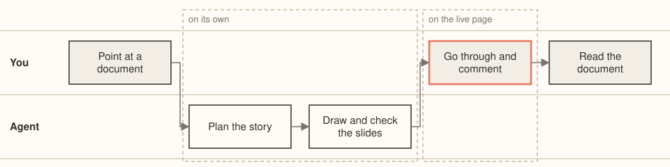

# `/show-better`

Introduces a dense document, such as a research paper, a strategy or a design doc, with a short story of visual slides you go through before you read it. Each slide shows one relation you would otherwise work out from the prose, every value is checked against the document, and you can ask about or correct any slide in the same page.

*You go through the story one slide at a time, click any label to comment, and the agent answers and changes the slide in place.*

## When to use it

- Before reading a long, dense document, to see the question it answers, its answer and how its main ideas relate.
- After an agent wrote a long report, to add a visual introduction to it.
- To turn that introduction into a short presentation for others.

It does not turn every point into a visual. A point one sentence states well stays a sentence. The slides introduce the document; they do not replace it.

Use something else nearby:

- For the wording of a text, use [`/write-better`](write-better.md). `/write-better` sends long, dense documents here.
- To design or build an interface, use [`/design-better`](design-better.md).

## What you can do with it

| You want to | Run | You get |
|---|---|---|
| Introduce a document | `/show-better reports/pricing-strategy.md` | 5 to 12 slides on a live page you can comment on |
| Introduce the agent's last output | `/show-better` | The same, for that output |
| Present it to others | Export from the page | One presentation file, or a copy to share without the conversation |
| Read it in a terminal | Ask for text | Plain text, Markdown, ASCII, or sentences for a screen reader |

In every introduction, it:

- **Tells the document's argument as a story.** The opening slide asks your question and answers it, and the headlines read in order make the argument.
- **Shows one relation per slide**, in a form chosen from more than twenty kinds, such as concept maps, actor lanes, forks, set diagrams and slope charts.
- **Checks every value against the document**, and links each slide to the section to read.

## Your workflow

*Your steps are on the top lane, the agent's on the bottom one. The terracotta outline marks where your input matters most.*

1. **Start it** on the document.
2. **Go through the slides** on the live page, with the buttons, the strip or the arrow keys. Click a mark for its detail and source.
3. **Comment** on any part of a slide, or ask a question. The agent replies under your message and changes the slides in place.
4. **Accept** each done item, then say you are done.
5. **Read the document**, starting from the sections the slides link to.

## How long it takes

**How you work with it:** it builds the slides on its own, then you lead a live session on the page for as long as you want to comment.

| Work | Rough time |
|---|---|
| Slides for one document | 10–20 min, without you |
| Review session on the page | 10–30 min, with you |

It takes longer for a longer document, and with each round of comments.

## Reference

<b>What happens</b>

1. **It names the goal.** It works out what you must understand, learn, do or decide after reading, and what you already know. For an expert reader it shows less. If it guesses the goal, it says so when it hands over.
2. **It reads the whole document** and writes an extract: your question and the document's answer, the parts, the relations between ideas, every value and claim with the section it comes from, and the case the document follows.
3. **It plans a story of 5 to 12 slides.** The opening slide asks your question and answers it. Each part of the story is the next question that follows, and each headline answers it, so the headlines read in order make the argument. Every slide must answer a question in that story.
4. **It picks a template and a visual for each slide.** Four templates: Title for the close, with each action linked to its slide; Visual for one relation; Compare for two things the document reports, on one scale; Statement for one figure with its comparison. Visuals come from more than twenty kinds, including concept maps, actor lanes with hand-offs, forks into outcomes, set diagrams, slope charts, dot plots and timelines. One vocabulary runs across every slide: terracotta marks the point, a mark's fill shows how strong its evidence is, and risk shows by glyph and word.
5. **It checks the slides.** A checker prints every headline, value, label, detail and source. The agent compares each against the extract and the document, and looks at the rendered slides for overlaps, cut-off labels and missing highlights.
6. **It shows you the slides** and works with you in the page until you say it is done.

If your project has its own colours and fonts, the slides and their drawings take them; the page around the slides keeps its look.

<b>What you get</b>

- **A live page**, served on your machine at `.show/<slug>/index.html`. One slide at a time, with a strip above that groups the slides under the story's parts; move with the buttons, the strip or the arrow keys. Click a label or a mark to see its detail: what it is, its source and how strong the evidence is. Each slide's source line links to the section of the document to read.
- **A conversation with the agent** in the column on the right. Switch to Comment (or press C) and click any part of a slide to comment on it, or write a message. The agent replies under your message, each item shows whether it is seen, being worked on or done, and you accept a done item or reply to send it back. Changed slides load in place once you stop typing.
- **Export**, which downloads the slides alone as one presentation file: arrow keys, space or clicks to move, F for full screen.
- **A copy to share.** Opened as a file or published as a link, the page shows the slides and their details without the conversation.
- **Text instead**, for a terminal or chat: plain text, Markdown, ASCII only, or sentences and value lists for a screen reader.
- The spec the slides were drawn from, `.show/<slug>/spec.json` (untracked in git until you commit or ignore it), and the document's answer stated in the chat.

<b>Works with</b>

- [`/write-better`](write-better.md) checks the wording of the title, headlines, labels, details and sources.
- [`/write-better`](write-better.md) calls `/show-better` to introduce a long, dense document.

<b>What it needs</b>

| Capability | Without it |
|---|---|
| Python 3, and a browser that can reach the machine where the agent runs | It publishes the slides as a page without the conversation if it can, or renders text or Markdown for the terminal or chat. |
| A harness that can run the page's own agent | It shows the problem in one line, then renders the slides as text. |
| Python 3 at all | It writes the slides in Markdown by hand: tables for comparisons, lists for structure, and plain-text diagrams only for flows of four short steps or fewer. It checks every value against the document by hand. |
| Viewing the page or a screenshot | It says it could not look at the result. |

